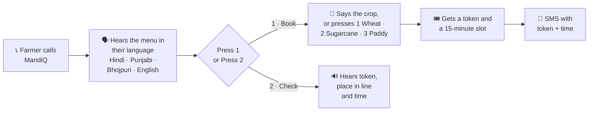
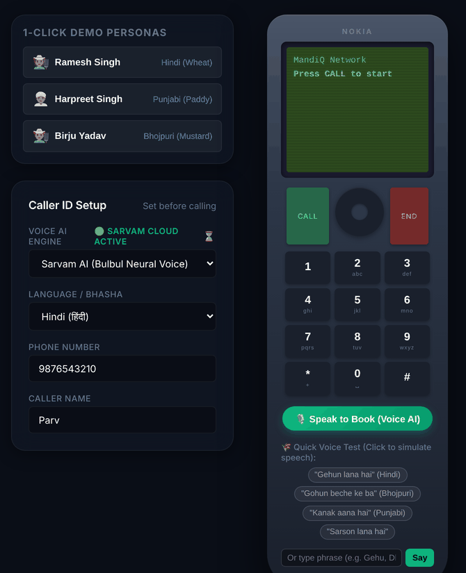
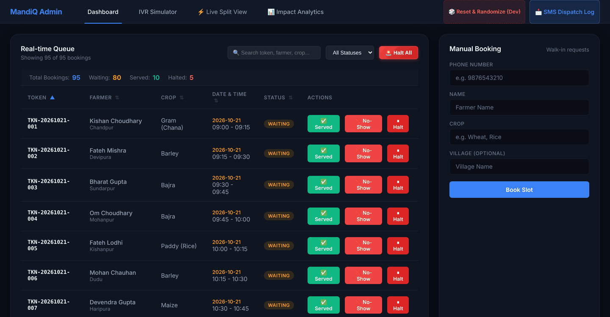
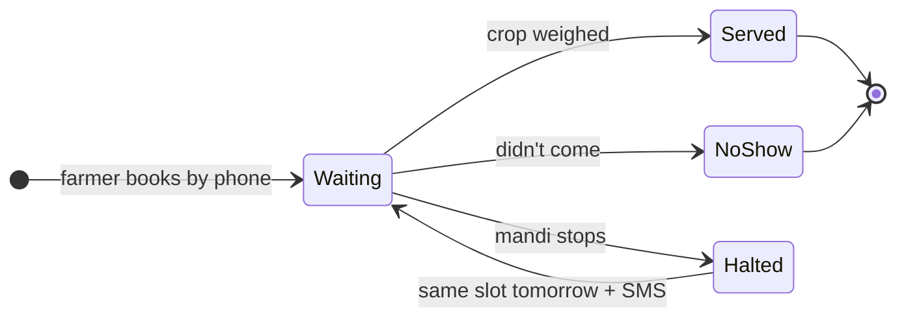
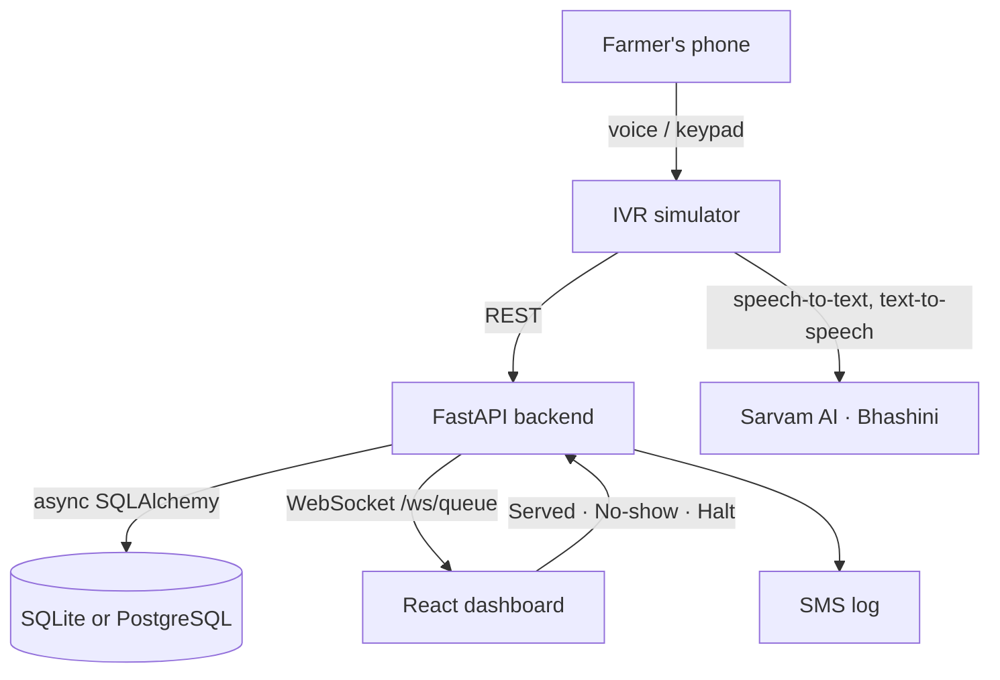

<div align="center">

<picture><source media="(prefers-color-scheme: dark)" srcset="docs/readme/banner-dark.svg"><source media="(prefers-color-scheme: light)" srcset="docs/readme/banner-light.svg"></picture>

**A farmer calls a number, presses 1, and gets a fixed time to bring their crop to the mandi.**
**No smartphone, no app, no middleman.**

[](https://frontend-omega-fawn-51.vercel.app/)
[](https://youtu.be/1_8FGb6jPUo)
[](https://mandiq-sih-2026.onrender.com/docs)


</div>

---

## The problem

At government procurement centres (mandis), farmers bring their crop on tractors and wait. Often they
don't know **when** weighing will start, so they wait at the gate for hours or even days. Early places
in the line can go to whoever knows someone, or pays. And when the mandi stops for the day, the farmers
in line find out only when they reach the gate.

Most apps meant to fix this assume a smartphone and the ability to read. Many farmers have neither:

<p align="center">
<picture><source media="(prefers-color-scheme: dark)" srcset="docs/readme/reach-dark.svg"><source media="(prefers-color-scheme: light)" srcset="docs/readme/reach-light.svg"></picture>
</p>

<sub>Sources: [NSS 77th round, Situation Assessment of Agricultural Households, 2019](https://ruralindiaonline.org/en/library/resource/situation-assessment-of-agricultural-households-and-land-and-livestock-holdings-of-households-in-rural-india/) · [Census 2011, via MoSPI *Women and Men in India 2014*, ch. 3](https://www.mospi.gov.in/sites/default/files/reports_and_publication/cso_social_statices_division/Chapter_3_2014.pdf) (adult literacy, age 15+)</sub>

**So MandiQ works with a phone call.** Any phone, even a basic keypad one. The farmer listens and
presses keys, or just says what they want, in Hindi, Punjabi, Bhojpuri or English.

---

## How a call works



Farmers can also just speak: *"Gehun lana hai"* (Hindi), *"Kanak aana hai"* (Punjabi) or
*"Gohun beche ke ba"* (Bhojpuri) all book a wheat slot. Speech is handled by Sarvam AI and the
government's Bhashini service.

<p align="center"></p>

<sub>The IVR simulator in the web app lets you try a call without a real phone line.</sub>

---

## What changes at the mandi

<p align="center">
<picture><source media="(prefers-color-scheme: dark)" srcset="docs/readme/compare-dark.svg"><source media="(prefers-color-scheme: light)" srcset="docs/readme/compare-light.svg"></picture>
</p>

<p align="center">
<picture><source media="(prefers-color-scheme: dark)" srcset="docs/readme/slots-dark.svg"><source media="(prefers-color-scheme: light)" srcset="docs/readme/slots-light.svg"></picture>
</p>

---

## The mandi officer's screen

<p align="center"></p>

The queue updates live, without refreshing. For each farmer the officer can mark them
**Served** or **No-show**, or **Halt** the booking, which moves it to the same time tomorrow and
sends the farmer an SMS. **Halt All** does that for the whole day in one click.

Every booking moves through the same few states:



---

## Try it

1. Open the **[live demo](https://frontend-omega-fawn-51.vercel.app/)** or watch the **[video](https://youtu.be/1_8FGb6jPUo)**.
2. Go to the **IVR Simulator** tab, pick a demo farmer, and press the green **CALL** button.
3. Press **1** to book, then pick a crop. You'll hear the confirmation and see the SMS.
4. Call again and press **2** to hear your token and time.
5. Back on the **Dashboard**, press **Halt** on any waiting farmer and watch them move to tomorrow.

---

## For developers

<details>
<summary><b>Architecture</b></summary>

<br>



**Rules the database enforces**

| Table | Rule |
|---|---|
| `farmers` | One record per phone number (`unique`) |
| `slots` | No two slots with the same date and time (`uq_slot_time`); 15 minutes, capacity 1 |
| `bookings` | Unique token; `waiting` → `served`, `no_show` or `halted` |
| `notifications` | Every halt and reschedule is logged as an SMS |

The booking endpoint also refuses a second **active** booking for the same phone number.

</details>

<details>
<summary><b>API</b></summary>

<br>

| Method | Path | What it does |
|---|---|---|
| `POST` | `/book` | Book the next free slot |
| `GET` | `/status/{phone}` | Token, place in line, slot time, status |
| `GET` | `/queue` | The live queue |
| `POST` | `/queue/update` | Mark `served` or `no_show` |
| `POST` | `/queue/halt` · `/queue/halt-all` | Move one or all bookings to the next day |
| `POST` | `/queue/reschedule` | Move a booking to another slot |
| `GET` | `/notifications` | The SMS log |
| `POST` | `/voice/tts` · `/voice/stt` · `/voice/process-speech` · `/voice/translate` | Speech via Sarvam AI / Bhashini |
| `WS` | `/ws/queue` | Live queue updates |

Interactive docs: **[mandiq-sih-2026.onrender.com/docs](https://mandiq-sih-2026.onrender.com/docs)**

</details>

<details>
<summary><b>Run it locally</b></summary>

<br>

Needs Python 3.10+ and Node.js 18+.

```bash
git clone https://github.com/abhishekgoswami0720/MandiQ.git
cd MandiQ

pip install -r requirements.txt
cp .env.example .env              # add your own Sarvam and Bhashini keys
uvicorn app.main:app --reload --port 8000

# second terminal
cd frontend
npm install
npm run dev                       # http://localhost:5173
```

To fill the queue with 100 demo farmers: `python seed_100_customers.py`.

**Environment variables** (in `.env` locally, or in Render's settings, never in the code):

| Variable | Used for |
|---|---|
| `DATABASE_URL` | Defaults to a local SQLite file |
| `SARVAM_API_KEY` | Sarvam AI speech |
| `BHASHINI_USER_ID`, `BHASHINI_API_KEY`, `BHASHINI_PIPELINE_URL` | Bhashini speech and translation |

</details>

<details>
<summary><b>Project layout</b></summary>

<br>

```text
MandiQ/
├── app/
│   ├── main.py               # FastAPI app, CORS, WebSocket
│   ├── parv_routes.py        # booking, status, queue, halt, reschedule
│   ├── voice_routes.py       # speech-to-text, text-to-speech, translation
│   ├── services/             # Sarvam AI and Bhashini clients
│   ├── nlp_matcher.py        # matches spoken crop names ("gehun", "kanak") to crops
│   ├── models.py, schemas.py, database.py
│   └── websocket_manager.py
├── frontend/src/
│   ├── components/           # PhoneSimulator, QueueTable, BookingForm, SmsDrawer, AnalyticsView
│   └── services/             # API client, WebSocket, offline demo data
├── seed_100_customers.py     # demo data
└── MandiQ_Farmer_Demographics_Report.pdf
```

</details>

---

## Team RootCause

Built for **Smart India Hackathon 2026**, problem statement **26032** (Ministry of Consumer Affairs,
Food & Public Distribution). MandiQ reached the **top 45 of 450+ teams** in the institute round at GLA University.

| | |
|---|---|
| **Abhishek Goswami** | Team lead |
| Parv Mishra | Team member |
| Pushkar Singhal | Team member |
| Priyanshu Kuntal | Team member |
| Medhavi Agarwal | Team member |
| Bhawana Singh | Team member |
